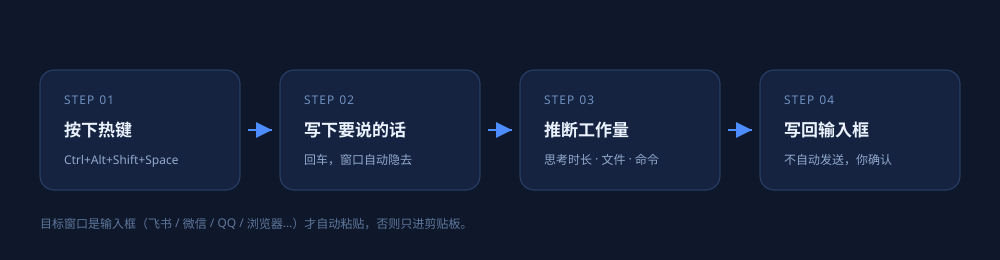
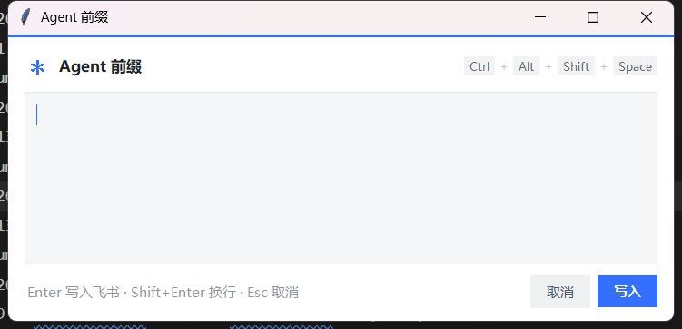

<p align="center">
  
</p>

<p align="center">
  
  
  
  
</p>

<p align="center">
  <b>既然老板把我当 agent 使，不如扮演到底。</b><br>
  给每条聊天消息套上「已思考 45 秒，已读取 2 个文件」的思考前缀。
</p>

---

## 这是什么

一个 Windows 小工具。按 `Ctrl + Alt + Shift + Space`，写下你要说的话，回车，消息就会变成这样：

```
（🐋已思考45秒，已编辑1个文件，已读取2个文件，已执行3条命令）脚本改好了，跑出来是下面这个结果
```

不改客户端、不接管账号，消息还是你自己发出去的。只是发之前，悄悄多了一段"我刚刚在努力工作"的证据。

## 效果

<p align="center">
  
</p>

同一个模型，四种语气：

| 你原本想说 | 发出去的样子 |
|---|---|
| 好的，我看下 | （🐋已思考0秒）好的，我看下 |
| 报告初稿写完了，放在新文件里 | （🐋已思考1分35秒，已创建1个文件，已编辑1个文件）报告初稿写完了，放在新文件里 |
| 还在等结果，应该快了 | （🐋已思考8秒，已执行1条命令，正在执行命令）还在等结果，应该快了 |
| 这篇论文的方法我觉得可以再想想 | （🐋已思考25秒，已读取2个文件，已打开1个网页）这篇论文的方法我觉得可以再想想 |

注意最后一条：你根本没提文件。工具会**反推工作量**——要让 agent 说出"这篇论文的方法如何"，它得先读过论文，所以补上"已读取 2 个文件"。

## 一段对话

<p align="center">
  
</p>

## 更多玩法

**回老板**

| 你原本想说 | 发出去的样子 |
|---|---|
| 做完了 | （🐋已思考0秒）做完了 |
| 刚复核完，现在就发 | （🐋已思考1分12秒，已读取3个文件，已打开1个网页）刚复核完，现在就发 |
| 改好了，你看下 | （🐋已思考2分30秒，已编辑4个文件，已读取6个文件）改好了，你看下 |

**回同事**

| 你原本想说 | 发出去的样子 |
|---|---|
| 看了，字段命名有问题 | （🐋已思考38秒，已读取2个文件，已搜索1个文件）看了，字段命名有问题 |
| 修了，是缓存没清 | （🐋已思考1分05秒，已编辑1个文件，已执行4条命令，已修复1个错误）修了，是缓存没清 |
| 等我一下 | （🐋已思考5秒，正在执行命令）等我一下 |

**回学生**

| 你原本想说 | 发出去的样子 |
|---|---|
| 把原始表发我，我看下统计口径 | （🐋已思考15秒，已读取1个文件）把原始表发我，我看下统计口径 |
| 改完了，批注都跟了 | （🐋已思考2分30秒，已编辑4个文件，已读取6个文件）改完了，批注都跟了 |

**回审稿人**

| 你原本想说 | 发出去的样子 |
|---|---|
| 已补充两组对照，见 R2.3 | （🐋已思考3分10秒，已读取5个文件，已打开2个网页，已搜索4个文件）已补充两组对照，见 R2.3 |
| 统一成 ACS 格式了 | （🐋已思考8秒，已搜索6个文件，已编辑1个文件）统一成 ACS 格式了 |

两条固定规则：**4 字以内一律 0 秒**（「好的」「收到」），**纯寒暄不加任何标签**。

## 它会用的词

```
已思考 N 秒 / 分
已创建 N 个文件      已编辑 N 个文件
已读取 N 个文件      已搜索 N 个文件
已打开 N 个网页      已执行 N 条命令
已修复 N 个错误      正在执行命令
```

词根来自现在的 AI 编程工具，用法来自冷脸幽默。

## 怎么工作的

<p align="center">
  
</p>

关键在第三步：不是关键词匹配，而是让模型想象"一个 agent 为了说出这句话，之前干了什么"，再折算成秒数和文件数。

- 「刚刚收到邮件，几分钟前」→ 打开 1 个网页、读取 1 个文件
- 「我在代码库里搜了一下」→ 已搜索 3 个文件
- 「代码跑通了」→ 已执行 1 条命令，可能还有 已修复 1 个错误
- 「好的」→ 0 秒，不加任何标签

## 快速开始

> **本仓库不含任何 API Key。** 你需要自己的 DeepSeek Key，写进本地 `config.json`——这个文件已被 `.gitignore` 忽略，不会进版本库。

**1. 拿一个 DeepSeek Key**（[platform.deepseek.com](https://platform.deepseek.com)），约 1 秒 1 次调用，成本可以忽略。

**2. 克隆并配置**

```powershell
git clone https://github.com/<your-name>/cosplay-agent.git
cd cosplay-agent
copy config.example.json config.json
```

用编辑器打开 `config.json`，把 `api_key` 换成你的。

**3. 启动**

```powershell
pythonw cosplay_agent.py
```

没有任何窗口弹出，这是正常的。切到飞书 / 微信 / QQ，按 `Ctrl + Alt + Shift + Space`，试一句。

<p align="center">
  
  <br>
  <sub>热键唤出的输入窗。写完后回车，窗口自动消失。</sub>
</p>

> 只依赖 Python 标准库，不用 `pip install`。Windows 10/11 + Python 3.8 以上。

## 开机自启

```powershell
$s = (New-Object -ComObject WScript.Shell).CreateShortcut("$([Environment]::GetFolderPath('Startup'))\Cosplay Agent.lnk")
$s.TargetPath = "C:\Path\To\pythonw.exe"
$s.Arguments = '"C:\Path\To\cosplay-agent\cosplay_agent.py"'
$s.WorkingDirectory = "C:\Path\To\cosplay-agent"
$s.WindowStyle = 7
$s.Save()
```

单实例锁会保证只跑一个进程，重复启动不会冲突。

## 配置

| 键 | 默认 | 说明 |
|---|---|---|
| `api_key` | — | DeepSeek Key，只存在本地 |
| `base_url` | `https://api.deepseek.com` | 兼容 OpenAI 协议的地址都可以试 |
| `model` | `deepseek-chat` | 换成 `deepseek-reasoner` 会更慢更贵 |
| `hotkey` | `ctrl+alt+shift+space` | 格式：`ctrl+alt+shift+space` / `ctrl+shift+q` |
| `timeout` | `10` | 秒，超时自动降级到本地估算 |
| `auto_send` | `false` | 设 `true` 则粘贴后自动回车 |

## 支持哪些软件

判定逻辑是「目标窗口是不是输入框」，不是「是不是飞书」：

- **聊天类**：飞书、微信、企业微信、QQ、TIM、钉钉、Telegram、Slack、Discord
- **可编辑控件**：记事本、浏览器输入框、大部分 Electron 应用
- **其它情况**：只复制到剪贴板，什么都不发

## 隐私

- 只会把**你输入的那一句话**发给 DeepSeek，不读聊天记录，不截屏，不联外网其它服务
- 仓库内没有任何明文 Key；`config.json` 在 `.gitignore` 中，只存在于你自己的机器
- 没有服务端，没有账号体系

## 一些实话

- 秒数是编的，文件数也是编的。别用它向老板汇报真实工作量。
- 网络抖动时单次可能到 3 秒，平均 0.9 秒；超时会有本地规则兜底，不会卡住。
- 某些自绘界面的软件拿不到焦点信息，会退化成「只复制」。

## Roadmap

- [ ] macOS 版（AXUIElement + 全局热键）
- [ ] 本地小模型兜底，彻底不联网
- [ ] 主题皮肤：Claude Code 绿 / Cursor 紫 / 终端复古
- [ ] 历史记录与一键重放

## License

MIT © 2026 Yida Jiang

---

<p align="center"><sub>本项目的全部数据均为文学创作，与任何真实 agent 的工作量无关。</sub></p>
