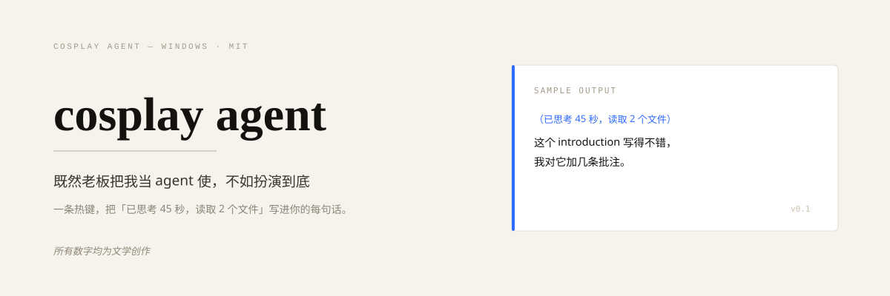

<p align="center">
  
</p>

<p align="center">
  <b>既然老板把我当 agent 使，不如扮演到底。</b><br>
  <sub>Windows · 零依赖 · 单文件</sub>
</p>

按一下 `Ctrl + Alt + Shift + Space`，写下要说的话，回车。发出去的是这样：

```
（🐋已思考45秒，已读取2个文件，已执行3条命令）图我改完了，你看下
```

不改客户端，不接管账号，消息还是你自己发出去的。只是发之前，多了一段"我刚刚在努力工作"的证据。

## 它现在这么说话

<p align="center">
  
</p>

| 原本想说 | 发出去 |
|---|---|
| 好的，我看下 | （🐋已思考0秒）好的，我看下 |
| 报告写完了，放在新文件里 | （🐋已思考1分35秒，已创建1个文件，已编辑1个文件）报告写完了，放在新文件里 |
| 这篇论文的方法可以再想想 | （🐋已思考25秒，已读取2个文件，已打开1个网页）这篇论文的方法可以再想想 |
| 等我一下 | （🐋已思考5秒，正在执行命令）等我一下 |

最后一条你没提文件。工具会反推工作量：要聊这篇论文，agent 总得先读过它。

## 实战场景

> 以下全部为表演。数字由模型现场编造，可用于情绪价值，不可用于绩效考核。

**敷衍女友**

| 原本想说 | 发出去 |
|---|---|
| 在忙，晚点说 | （🐋已思考0秒，正在执行命令）在的，手上有个任务跑到一半，跑完第一个找你 |
| 忘了 | （🐋已思考0秒）刚在收尾一个紧急项，现在就处理你的 |

**甩锅**

| 原本想说 | 发出去 |
|---|---|
| 这不是我负责的 | （🐋已思考3秒，已读取1个文件）这块上周已交接给王哥，记录在群里，我拉他一起看？ |
| 延期不怪我 | （🐋已思考1分20秒，已读取6个文件，已执行2条命令）链路从头拉了一遍，卡在等设计稿，下午对齐一下 |

**汇报与拒绝**

| 原本想说 | 发出去 |
|---|---|
| 本周干了啥 | （🐋已思考2分10秒，已编辑5个文件，已执行12条命令）本周打通内容侧赛道，沉淀一套 AI 打法，下周对齐颗粒度形成闭环 |
| 这个做不了 | （🐋已思考12秒，已读取2个文件）当前排期不支持，建议下沉到下个迭代，先跑 MVP 验证 |
| 明天想请假 | （🐋已思考0秒）明天处理点家庭事务，进度已同步，不影响交付 |

**黑话备用词库**（复制即用）：打通链路 · 沉淀打法 · 对齐颗粒度 · 形成闭环 · 拉齐认知 · 赋能 · 抓手 · 落地 · 复用

这些句子没有一句是真的。唯一真实的是——你确实在演。

## 一段对话

<p align="center">
  
</p>

## 三分钟用起来

1. 去 [platform.deepseek.com](https://platform.deepseek.com) 拿个 Key，约 1 秒 1 次调用，成本可忽略
2. `copy config.example.json config.json`，把 Key 填进去
3. `pythonw cosplay_agent.py`

<p align="center">
  
  <br>
  <sub>热键唤出的输入框。回车即走，不用手动关。</sub>
</p>

零依赖，Python 3.8+，Windows 10/11。浏览器、飞书、微信、QQ 的输入框都认。

<details>
<summary>开机自启</summary>

```powershell
$s = (New-Object -ComObject WScript.Shell).CreateShortcut("$([Environment]::GetFolderPath('Startup'))\Cosplay Agent.lnk")
$s.TargetPath = "C:\Path\To\pythonw.exe"
$s.Arguments = '"C:\Path\To\cosplay-agent\cosplay_agent.py"'
$s.WorkingDirectory = "C:\Path\To\cosplay-agent"
$s.WindowStyle = 7
$s.Save()
```

</details>

<details>
<summary>它到底怎么算的</summary>

<p align="center">
  
</p>

不是关键词匹配。让模型先想象"一个 agent 为了说出这句话，之前干了什么"，再折算成秒数和文件数。所以「刚刚收到邮件」会自动带上"打开 1 个网页、读取 1 个文件"。

</details>

## 它会说的词

```
已思考 N 秒 / 分
已创建 · 已编辑 · 已读取 · 已搜索   N 个文件
已打开 N 个网页 · 已执行 N 条命令 · 已修复 N 个错误 · 正在执行命令
```

两条硬规则：4 字以内固定 0 秒，纯寒暄不加任何标签。

## 配置

| 键 | 说明 |
|---|---|
| `api_key` | 必填，只存本地 |
| `hotkey` | 默认 `ctrl+alt+shift+space` |
| `auto_send` | 默认 `false`，只粘贴不回车 |
| `model` `base_url` `timeout` | 一般不用动 |

## 说点实话

- 秒数和文件数都是编的。别拿去汇报真实工作量。
- 只把**你输入的这一句**发给 DeepSeek，不读聊天记录，不截屏。
- 认不出输入框时，只复制到剪贴板，什么都不发。
- 仓库里没有任何 Key，`config.json` 在 `.gitignore` 里。

MIT © 2026 Yida Jiang
